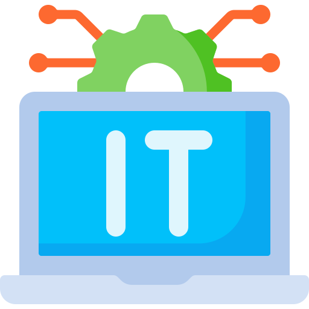
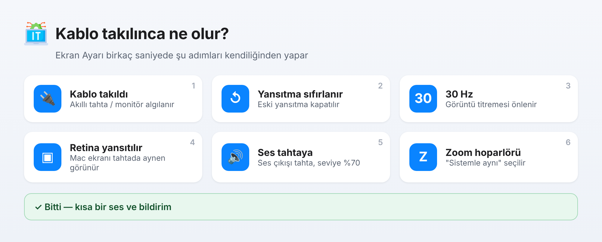
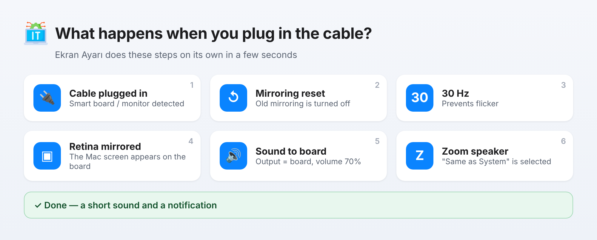

<p align="center"></p>

<h1 align="center">Ekran Ayarı</h1>

<p align="center">
Akıllı tahta / harici ekran için macOS yardımcısı · A macOS helper for smart boards and external displays<br>
<b>📘 <a href="docs/KULLANIM_KILAVUZU.md">Kullanım Kılavuzu (Türkçe)</a></b> · <b>📗 <a href="docs/USER_GUIDE.md">User Guide (English)</a></b>
</p>

---

## 🇹🇷 Türkçe

Kabloyu takın, gerisini Ekran Ayarı yapsın: yansıtmayı sıfırlar, ekranı **30 Hz** yapar, **Retina ekranı yansıtır**, sesi akıllı tahtaya verir (**%70**), açık **Zoom** toplantısında hoparlörü **"Sistemle aynı"** seçer.

### Kurulum (tek satır)
Mac'te **Terminal**'i açın (Spotlight ⌘+Boşluk → "Terminal"), aşağıdaki satırı yapıştırıp **Enter**'a basın:

```bash
curl -fsSL https://raw.githubusercontent.com/anurayli/ekranayari/main/kur.sh | bash
```

Ardından izin pencerelerinde **İzin Ver**'e basın ve **Erişilebilirlik** listesinde **EkranAyari**'nın anahtarını açın. Ayrıntılar: **[Kullanım Kılavuzu](docs/KULLANIM_KILAVUZU.md)**.



### Özellikler (sürüm 11)
| | |
|---|---|
| 🔌 **Kablo takılınca otomatik** | Arka planda bekleyen izleyici, ekran takılınca ayarları kendiliğinden yapar |
| 🖥 **Yansıtma + 30 Hz** | Yerleşik Retina ekranı tahtaya yansıtır, yenileme hızını 30 Hz yapar |
| 🔊 **Ses** | Ses çıkışını akıllı tahtaya verir, seviyeyi %70 yapar |
| 🎥 **Zoom** | Toplantı açıkken / başlayınca hoparlörü "Sistemle aynı" seçer |
| ☕️ **Uykuyu engelle** | Ekran bağlıyken Mac uykuya geçmez |
| 🔕 **Bildirimleri sustur** | Ders sırasında bildirimleri susturma ayarına yol gösterir |
| 🔄 **Kendini günceller** | Yeni sürümleri ve ayarları GitHub'dan kendisi alır |
| 📍 **Menü çubuğu** | Şimdi çalıştır, otomatik aç/kapat, kayıtlar, hakkında |

---

## 🇬🇧 English

Plug in the cable and Ekran Ayarı does the rest: resets mirroring, sets the display to **30 Hz**, **mirrors the built-in Retina display**, routes sound to the smart board (**70 %**) and sets the **Zoom** speaker to **"Same as System"** in an open meeting.

### Install (one line)
Open **Terminal** on the Mac (Spotlight ⌘+Space → "Terminal"), paste the line below and press **Return**:

```bash
curl -fsSL https://raw.githubusercontent.com/anurayli/ekranayari/main/kur.sh | bash
```

Then click **Allow** in the permission dialogs and turn on **EkranAyari** in the **Accessibility** list. Details: **[User Guide](docs/USER_GUIDE.md)**.



### Features (version 11)
| | |
|---|---|
| 🔌 **Automatic on cable** | A small background watcher applies the settings when a display is connected |
| 🖥 **Mirroring + 30 Hz** | Mirrors the built-in Retina display, sets the refresh rate to 30 Hz |
| 🔊 **Sound** | Sends audio to the smart board, volume 70 % |
| 🎥 **Zoom** | Selects "Same as System" as the speaker when a meeting is open / starts |
| ☕️ **Stay awake** | The Mac won't sleep while the display is connected |
| 🔕 **Silence notifications** | Guides you to the setting that silences notifications in class |
| 🔄 **Self-updating** | Gets new versions and settings from GitHub automatically |
| 📍 **Menu bar** | Run now, auto on/off, logs, about |

---

## Yöneticiler için · For administrators

- **`sunucu/ayarlar.json`** — tüm Mac'lerin ayarları (derleme gerekmez) · settings for all Macs (no rebuild):
  `hedefHz`, `sesSeviyesi` (`-1` = dokunma / don't touch), `zoomAyarla`, `otomatikIzleme`, `zoomToplantisiniIzle`, `uykuyuEngelle`, `dockaSabitle`, `bitisSesi`
- **`sunucu/zoom.applescript`** — Zoom adımı · Zoom step
- **`kaynak/main.swift`** — kaynak kod · source. GitHub'a yüklenince **Actions › Paketle** derler ve yayınlar (başlamazsa *Run workflow*) · on upload, **Actions › Paketle** builds and publishes (use *Run workflow* if it doesn't start).
- Kayıtlar · Logs: `~/Library/Logs/EkranAyari.log`

<p align="center"><sub>Geliştirici · Developer: <b>Ali NURAYLI</b> · © 2026</sub></p>
