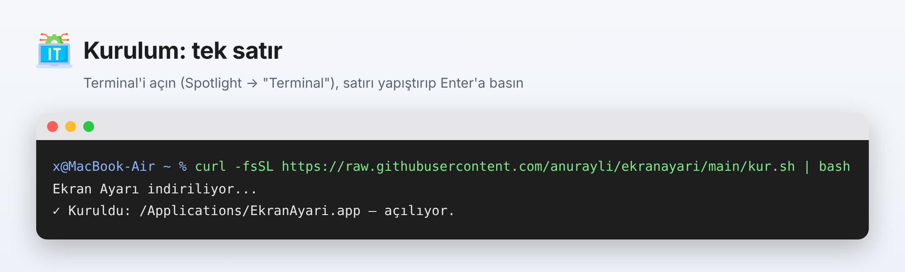
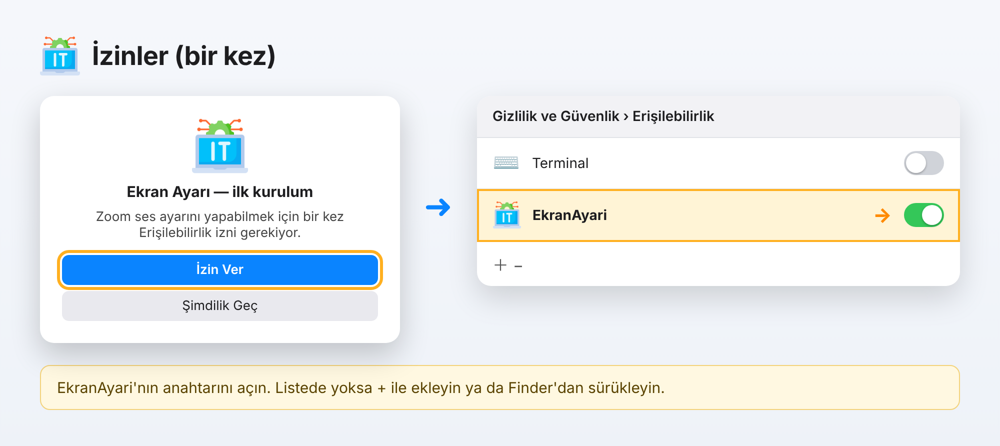
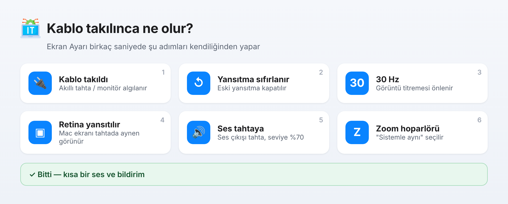
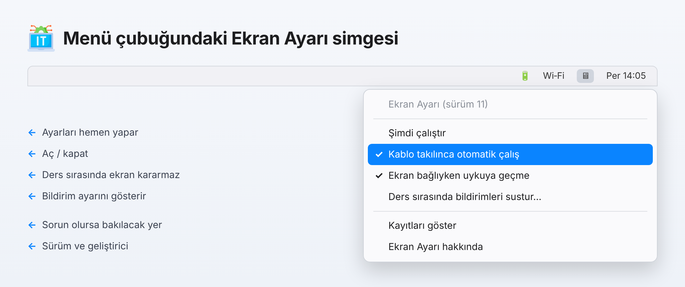
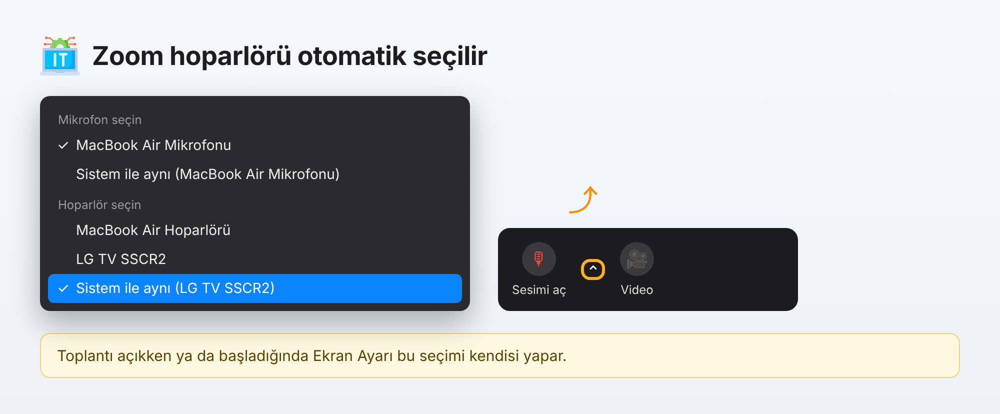
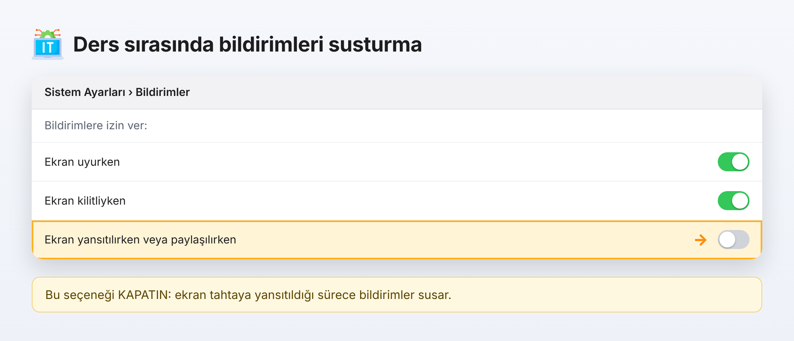

# Ekran Ayarı — Kullanım Kılavuzu

🇬🇧 [English version](USER_GUIDE.md) · [Ana sayfa](../README.md)

Ekran Ayarı, Mac'i akıllı tahtaya veya harici bir ekrana bağladığınızda gereken ayarları kendiliğinden yapar. Bir kez kurulur, sonra kabloyu takmanız yeterlidir.

**İçindekiler:** [1. Kurulum](#s1) · [2. İzinler](#s2) · [3. Günlük kullanım](#s3) · [4. Menü](#s4) · [5. Zoom](#s5) · [6. Bildirimleri susturma](#s6) · [7. Sorun giderme](#s7) · [8. Kaldırma](#s8)

---

<a id="s1"></a>

## 1. Kurulum

1. Mac'te **Terminal**'i açın: **⌘ + Boşluk** tuşlarına basın, `Terminal` yazın, **Enter**'a basın.
2. Aşağıdaki satırı kopyalayıp Terminal'e yapıştırın (**⌘ + V**) ve **Enter**'a basın:

```bash
curl -fsSL https://raw.githubusercontent.com/anurayli/ekranayari/main/kur.sh | bash
```



Komut, son sürümü indirip **Uygulamalar** klasörüne kurar ve açar. Daha önce kuruluysa üzerine yazar (güncelleme için de aynı satır kullanılabilir).

> **Terminal kullanmadan:** [EkranAyari.zip](https://github.com/anurayli/ekranayari/raw/main/sunucu/EkranAyari.zip) dosyasını indirip açın, **EkranAyari.app**'ı **Uygulamalar** klasörüne sürükleyin. İlk açılışta uygulamaya **sağ tıklayıp → Aç**'ı seçin.

<a id="s2"></a>

## 2. İzinler (bir kez)

İlk açılışta macOS birkaç izin sorar. Hepsine **İzin Ver** deyin:

- **"System Events'i denetlemek istiyor"** → **İzin Ver**
- **"Yerel ağdaki aygıtları bulmak istiyor"** (sorulursa) → **İzin Ver**
- **"Ekran Ayarı — ilk kurulum"** penceresi → **İzin Ver**. Açılan **Sistem Ayarları › Gizlilik ve Güvenlik › Erişilebilirlik** listesinde **EkranAyari**'nın anahtarını açın.



**EkranAyari listede yoksa:** listenin altındaki **+** düğmesine basın, **Uygulamalar › EkranAyari**'yı seçin ya da Finder'da seçili gelen uygulamayı listeye sürükleyin; sonra anahtarı açın.

> Uygulama yeni bir sürüme güncellendiğinde macOS onu yeni bir program sayar; izin penceresi bir kez daha çıkabilir. Aynı şekilde anahtarı açmanız yeterli.

<a id="s3"></a>

## 3. Günlük kullanım

Hiçbir şey yapmanıza gerek yok: **akıllı tahta / monitör kablosunu takın.** Birkaç saniye içinde Ekran Ayarı şunları yapar:



1. Eski yansıtmayı kapatır
2. Ekranın yenileme hızını **30 Hz** yapar
3. Mac'in **Retina ekranını** tahtaya yansıtır
4. Ses çıkışını **akıllı tahtaya** verir, ses seviyesini **%70** yapar
5. Açık bir **Zoom** toplantısı varsa hoparlörü **"Sistemle aynı"** seçer
6. Kısa bir ses ve bildirimle işin bittiğini haber verir

Ayarlar zaten doğruysa ekran boş yere titremez; Ekran Ayarı sadece eksik olanı yapar. Elle çalıştırmak için Dock'taki veya menü çubuğundaki simgeye tıklayabilirsiniz.

<a id="s4"></a>

## 4. Menü çubuğu simgesi

Ekranın sağ üstündeki **🖥 simgesine** tıklayınca:



| Seçenek | Ne yapar |
|---|---|
| **Şimdi çalıştır** | Ayarları hemen yapar |
| **Kablo takılınca otomatik çalış** | Otomatik çalışmayı açar / kapatır (✓ = açık; kapalıyken simge soluk görünür) |
| **Ekran bağlıyken uykuya geçme** | Ders sırasında ekranın kararmasını engeller |
| **Ders sırasında bildirimleri sustur…** | Bildirimleri susturma ayarını gösterir (bkz. bölüm 6) |
| **Kayıtları göster** | Ne yapıldığını gösteren kayıt dosyasını açar |
| **Ekran Ayarı hakkında** | Sürüm ve geliştirici bilgisi |

<a id="s5"></a>

## 5. Zoom

Ekran bağlıyken bir Zoom toplantısı **açıksa** veya **başlarsa**, Ekran Ayarı mikrofon düğmesinin yanındaki oku açar ve hoparlör olarak **"Sistemle aynı"** seçeneğini işaretler. Böylece ses akıllı tahtadan gelir.



Bu sırada fareyi kullansanız bile seçim doğru yere yapılır.

<a id="s6"></a>

## 6. Ders sırasında bildirimleri susturma

macOS bunu kendisi yapabilir; her Mac'te **bir kez** ayarlayın:

1. **Sistem Ayarları › Bildirimler**'i açın (ya da menüden **Ders sırasında bildirimleri sustur… › Ayarları Aç**).
2. **Bildirimlere izin ver** bölümünde **"Ekran yansıtılırken veya paylaşılırken"** seçeneğini **kapatın**.



Ekran tahtaya yansıtıldığı sürece bildirimler susar; kablo çıkınca geri gelir.

<a id="s7"></a>

## 7. Sorun giderme

| Sorun | Çözüm |
|---|---|
| Zoom hoparlörü seçilmiyor | **Erişilebilirlik** izninde **EkranAyari** açık mı? Kapalıysa açın; açıksa **–** ile silip **+** ile yeniden ekleyin, sonra uygulamayı yeniden açın. |
| Kablo takılınca hiçbir şey olmuyor | Menüden **Kablo takılınca otomatik çalış** işaretli mi? Menü çubuğunda simge yoksa uygulamayı bir kez elle açın. |
| 30 Hz olmuyor | Bazı ekranlar 30 Hz desteklemez; bu adım atlanır, diğerleri yapılır. |
| "Açılamıyor" uyarısı | Uygulamaya **sağ tıklayın → Aç**. Ya da kurulumu Terminal komutuyla yapın. |
| Ne olduğunu görmek istiyorum | Menüden **Kayıtları göster** (dosya: `~/Library/Logs/EkranAyari.log`). |

Kurulum komutunu yeniden çalıştırmak çoğu sorunu çözer.

<a id="s8"></a>

## 8. Kaldırma

Terminal'e yapıştırın:

```bash
launchctl bootout gui/$(id -u)/tr.k12.sevizmir.ekranayari.izleyici 2>/dev/null; rm -f ~/Library/LaunchAgents/tr.k12.sevizmir.ekranayari.izleyici.plist; killall EkranAyari 2>/dev/null; rm -rf /Applications/EkranAyari.app ~/Applications/EkranAyari.app
```

Sonra Dock'tan simgeyi sürükleyip çıkarın ve **Erişilebilirlik** listesinden **EkranAyari**'yı **–** ile silin.

---

<sub>Geliştirici: <b>Ali NURAYLI</b> · © 2026</sub>
