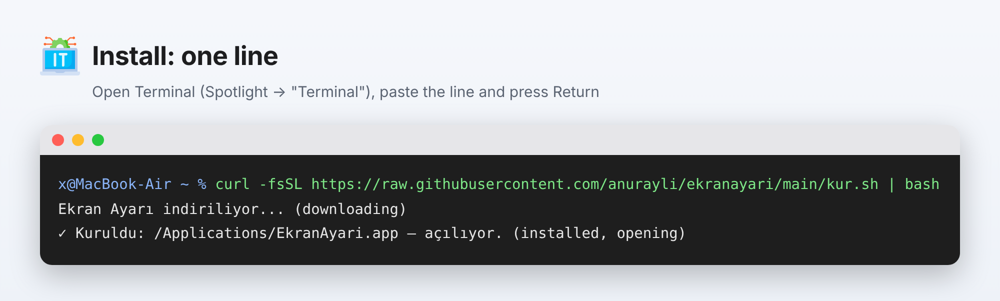
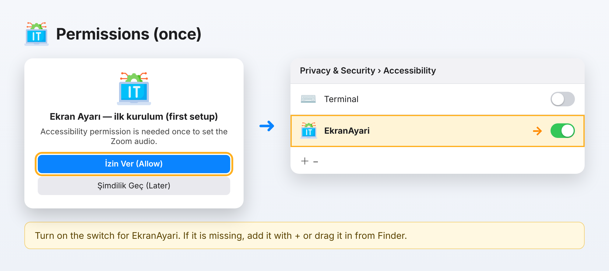
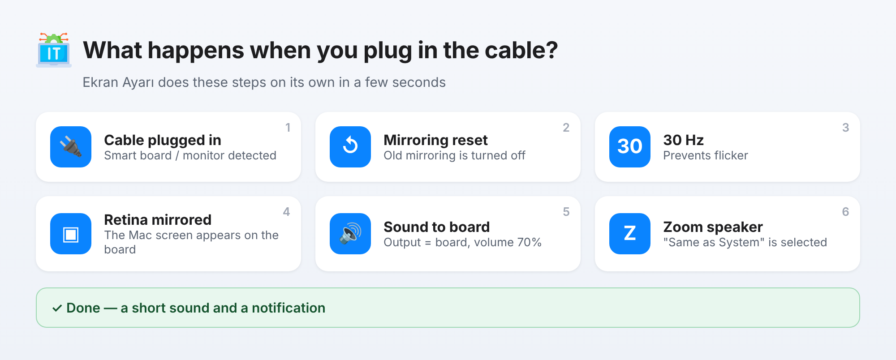
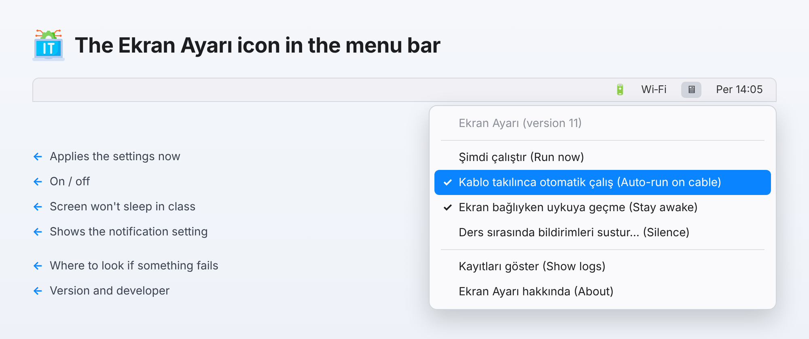
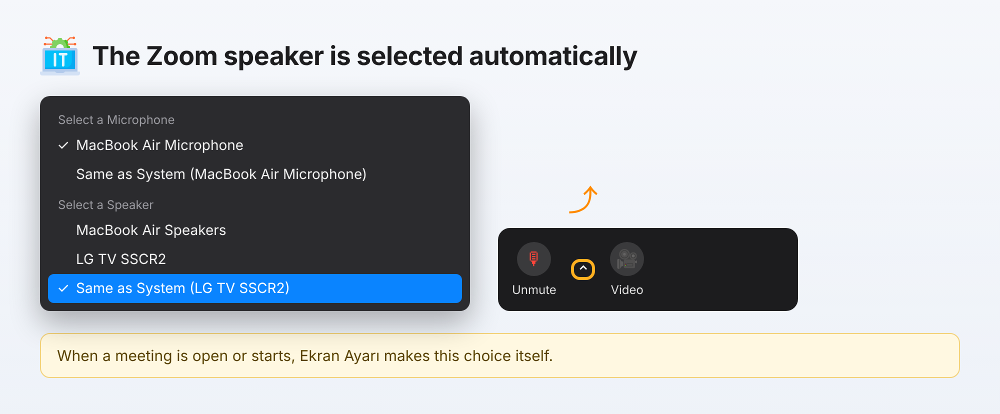
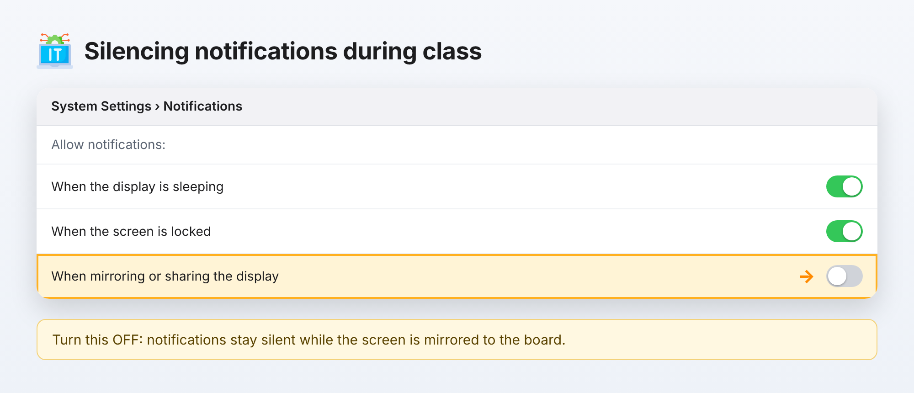

# Ekran Ayarı — User Guide

🇹🇷 [Türkçe sürüm](KULLANIM_KILAVUZU.md) · [Home](../README.md)

Ekran Ayarı applies the right settings automatically when you connect a Mac to a smart board or an external display. Install it once — after that, just plug in the cable.

> The app's interface is in Turkish. The English translation of each menu item is given below.

**Contents:** [1. Install](#s1) · [2. Permissions](#s2) · [3. Everyday use](#s3) · [4. Menu](#s4) · [5. Zoom](#s5) · [6. Silencing notifications](#s6) · [7. Troubleshooting](#s7) · [8. Uninstall](#s8)

---

<a id="s1"></a>

## 1. Install

1. Open **Terminal** on the Mac: press **⌘ + Space**, type `Terminal`, press **Return**.
2. Copy the line below, paste it into Terminal (**⌘ + V**) and press **Return**:

```bash
curl -fsSL https://raw.githubusercontent.com/anurayli/ekranayari/main/kur.sh | bash
```



The command downloads the latest version into the **Applications** folder and opens it. If it is already installed it is replaced (use the same line to update).

> **Without Terminal:** download [EkranAyari.zip](https://github.com/anurayli/ekranayari/raw/main/sunucu/EkranAyari.zip), open it and drag **EkranAyari.app** into **Applications**. On first launch, **right-click the app → Open**.

<a id="s2"></a>

## 2. Permissions (once)

On first launch macOS asks for a few permissions. Click **Allow** (*İzin Ver*) for all of them:

- **"…wants to control System Events"** → **Allow**
- **"…would like to find devices on your local network"** (if asked) → **Allow**
- The **"Ekran Ayarı — ilk kurulum"** (first setup) window → **İzin Ver**. In **System Settings › Privacy & Security › Accessibility**, turn on the switch for **EkranAyari**.



**If EkranAyari is not in the list:** click **+** below the list and choose **Applications › EkranAyari**, or drag the app (selected in Finder) into the list; then turn the switch on.

> After the app updates itself, macOS treats it as a new program, so the permission dialog may appear once more. Just turn the switch on again.

<a id="s3"></a>

## 3. Everyday use

Nothing to do — **plug in the smart board / monitor cable.** Within a few seconds Ekran Ayarı:



1. Turns off any old mirroring
2. Sets the refresh rate to **30 Hz**
3. **Mirrors the Mac's Retina display** to the board
4. Sends sound to the **smart board** and sets volume to **70 %**
5. If a **Zoom** meeting is open, sets the speaker to **"Same as System"**
6. Confirms with a short sound and a notification

If everything is already correct, the screen doesn't flicker — only what's missing is changed. To run it manually, click the icon in the Dock or in the menu bar.

<a id="s4"></a>

## 4. Menu bar icon

Click the **🖥 icon** at the top right of the screen:



| Item (Turkish) | English | What it does |
|---|---|---|
| **Şimdi çalıştır** | Run now | Applies the settings immediately |
| **Kablo takılınca otomatik çalış** | Run automatically on cable | Turns automatic mode on / off (✓ = on; icon is dimmed when off) |
| **Ekran bağlıyken uykuya geçme** | Stay awake while connected | Prevents the screen from sleeping during class |
| **Ders sırasında bildirimleri sustur…** | Silence notifications in class… | Shows the notification setting (see section 6) |
| **Kayıtları göster** | Show logs | Opens the log of what was done |
| **Ekran Ayarı hakkında** | About Ekran Ayarı | Version and developer |

<a id="s5"></a>

## 5. Zoom

When a Zoom meeting **is open** or **starts** while the display is connected, Ekran Ayarı opens the arrow next to the microphone button and selects **"Same as System"** as the speaker, so sound comes from the smart board.



The selection lands in the right place even if you move the mouse at that moment.

<a id="s6"></a>

## 6. Silencing notifications during class

macOS can do this itself — set it **once** on each Mac:

1. Open **System Settings › Notifications** (or use the menu: **Ders sırasında bildirimleri sustur… › Ayarları Aç**).
2. Under **Allow notifications**, turn **off** **"When mirroring or sharing the display"**.



Notifications stay silent while the screen is mirrored to the board and come back when the cable is unplugged.

<a id="s7"></a>

## 7. Troubleshooting

| Problem | Solution |
|---|---|
| Zoom speaker isn't selected | Is **EkranAyari** turned on under **Accessibility**? If it is, remove it with **–**, add it again with **+**, then reopen the app. |
| Nothing happens when the cable is plugged in | Is **Kablo takılınca otomatik çalış** checked in the menu? If there's no menu bar icon, open the app once manually. |
| 30 Hz isn't applied | Some displays don't support 30 Hz; that step is skipped, the others still run. |
| "Cannot be opened" warning | **Right-click the app → Open**, or install with the Terminal command. |
| I want to see what happened | Menu → **Kayıtları göster** (file: `~/Library/Logs/EkranAyari.log`). |

Running the install command again fixes most problems.

<a id="s8"></a>

## 8. Uninstall

Paste into Terminal:

```bash
launchctl bootout gui/$(id -u)/tr.k12.sevizmir.ekranayari.izleyici 2>/dev/null; rm -f ~/Library/LaunchAgents/tr.k12.sevizmir.ekranayari.izleyici.plist; killall EkranAyari 2>/dev/null; rm -rf /Applications/EkranAyari.app ~/Applications/EkranAyari.app
```

Then drag the icon out of the Dock and remove **EkranAyari** from the **Accessibility** list with **–**.

---

<sub>Developer: <b>Ali NURAYLI</b> · © 2026</sub>
